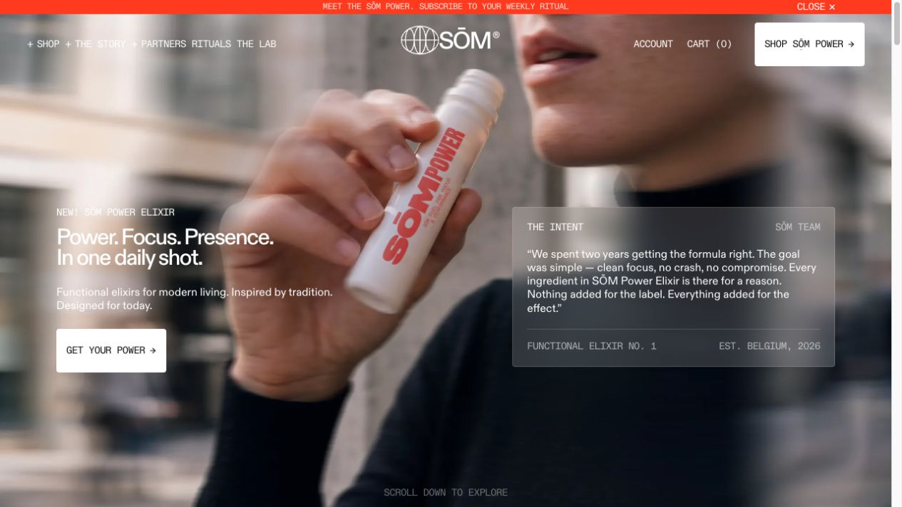
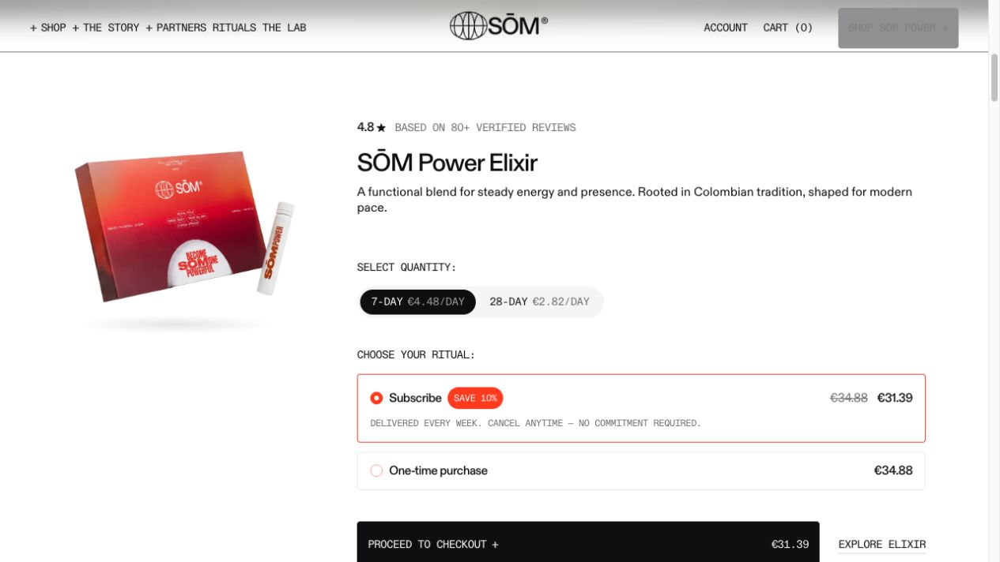
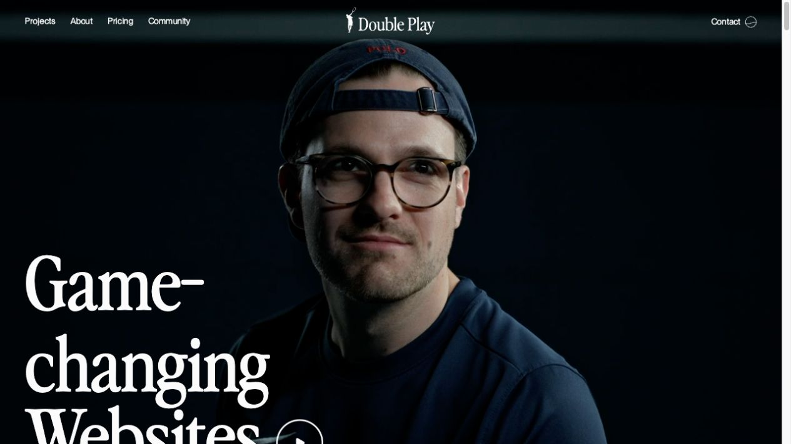
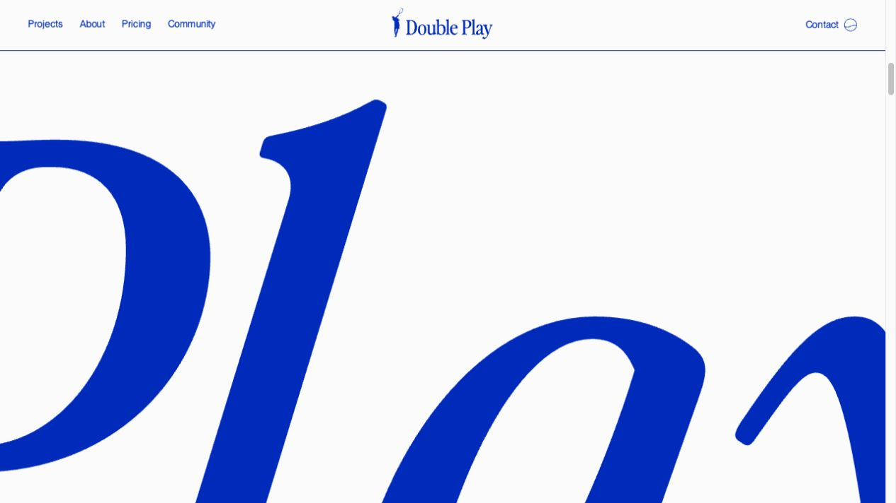

# DESIGN — 儿童运动成长平台 · 家长端

> 面向家长与儿童的界面设计规范 / 前端负责人交付依据  
> 版本：1.0 · 2026-11-07  
> 交付范围：设计语言、页面结构、组件状态、动效、数据交互约定与验收标准。本文中的组件名、接口和路由均为建议契约，不代表仓库中已实现的能力。主要用于黑客松的演示的前端设计

## 1. 设计定位

**让每一次运动，都成为孩子宇宙里的一颗星。**

家长首先感受到专业、可信和清晰；孩子首先感受到探索、参与和被鼓励。整体采用现代运动科技产品的气质，以真实运动影像建立情绪，以编辑式排版建立品牌，以可交互的成长宇宙表达长期价值。

视觉由三部分组成：Double Play 的运动张力与衬线大字、SŌM 的精确标签与产品秩序、属于本产品的深蓝成长星图。浅色页面负责阅读与决策，深色星图负责探索与庆祝，两者共享字体、间距、线条和状态语言。

核心判断标准：

1. 首次进入能看懂“为谁服务、能做什么、下一步去哪”。
2. 主要页面各有明确构图：品牌首页、教练画册、预约清单、对话工作区、个人成长档案、沉浸星图。
3. 儿童友好通过语气、真实影像和温和反馈体现；避免满屏卡通、奖励轰炸和排名压力。
4. 每一颗业务星星都有来源，能够追溯到孩子、课程、训练记录和教练反馈。
5. 黑客松演示的视觉高潮来自一次真实写入后的星星点亮。

## 2. 参考分析与证据

### 2.1 研究范围与可信度

本次直接访问并观察了 [SŌM 首页](https://www.drinksom.eu/) 与 [Double Play 首页](https://www.doubleplay.studio/)，结合当前页面截图、渲染后的 DOM 与计算样式提取规则。桌面浏览器视口约为 1280 × 720，内容宽度约 1265 px，差值来自滚动条。

下文用三个标签区分信息：

- **实测**：本次读取到的字体声明、计算色值、尺寸、间距和 CSS 过渡参数。
- **观察**：从截图、页面滚动和界面结构中归纳出的视觉方法。
- **项目规范**：为本平台制定的应用规则，包括所有断点、星图参数与业务动效时间。

未完整测试参考站的移动端、所有悬停态、键盘访问、完整交易流程或全部滚动动画；不把截图分析当作完整无障碍审计。视频画面会随时间变化，截图只代表捕获时的一帧。未提取的脚本动画时长不作精确断言。

### 2.2 SŌM：精确、克制、有生活感的科技产品

来源：[drinksom.eu](https://www.drinksom.eu/)。证据见图 01、02。

| 维度 | 实测 / 观察 | 提取的设计规则 |
| --- | --- | --- |
| 配色 | 主文字 `#0E0F11`；白色 `#FFFFFF`；强调橙红 `#FF3A1F`；浅灰 `#ECECEC`、`#F5F5F5`；部分暖色 `#FFF3E7`、`#FFE6DC` | 中性色承担大面积信息；高饱和色集中用于提示、选中和品牌重点 |
| 字体 | `ABC Diatype` 无衬线；`ABC Diatype Mono` 等宽 | 标题、正文与技术标签分工明确；用等宽字制造精密感 |
| 标题 | 当前视口 H1 为 32 px / 29.44 px，500，字距 -1.76 px；产品标题 32 / 32.64；部分章节标题 44 / 40.48 | 字号并非一味放大；短行、紧凑行距、准确断行形成辨识度 |
| 正文与标签 | 正文基准 16 / 24；导航及部分标签 14 / 16.24 等宽 | 说明文字保持可读，标签表达分类和事实 |
| 排版 | 首屏全幅动态影像；左侧文案、右侧半透明说明板；产品区图片与决策表单左右分栏 | 一屏一个主对象；品牌叙事与购买决策有不同密度 |
| 留白 | 首屏文案左距约 80 px；当前导航横向内边距约 38.4 px；多个章节上下留白 120 px，社区章节顶部 220 px | 内容区域留白形成章节感；导航可以更贴近屏幕边缘 |
| 组件 | 4 px 小圆角按钮与选择框；细描边；数量分段选择；套餐单选；图文横向内容组 | 用边框、文字与选中标识建立层次，阴影使用克制 |
| 动效 | 实测链接透明度过渡 150 ms；导航、图标旋转与背景切换多为 300 ms；常见缓动 `cubic-bezier(.4,0,.2,1)` | 短动效解释状态；背景影像承担持续运动；页面提供旋转瓶身入口，但本次未验证其完整行为 |

**迁移方式：** 教练详情沿用“主体影像 + 清晰决策区”；预约沿用有描边的课程 / 时段选择；运动标签与训练记录采用精确的小字号元信息。半透明面板仅用于影像与星图上的少量文字。

### 2.3 Double Play：运动影像、编辑感和大尺度节奏

来源：[doubleplay.studio](https://www.doubleplay.studio/)。证据见图 03、04。

| 维度 | 实测 / 观察 | 提取的设计规则 |
| --- | --- | --- |
| 配色 | 内容主蓝 `#002BBA`；近白底 `#FBFBFB`；页面还声明 `#121212` 与默认 `#333333` | 蓝白对比形成鲜明品牌；深色影像与浅色章节交替 |
| 字体 | 展示字体 `Perfectly Nineties`；正文与导航 `Neue Montreal`；body 的 Arial 是默认声明，不能据此判定页面主要用 Arial | 衬线大字承担情绪，无衬线承担功能信息 |
| 标题 | H1 120 / 132 px，500，字距 -0.75 px；H2 64 / 76.8 px，500，字距 -0.8 px | 超大文字本身成为画面；大小层级反差明显 |
| 正文 | 使命段落 32 / 35.2 px，500；流程说明 18 / 23.4 px；导航约 14 / 18.2 px | 关键陈述像杂志导语，具体说明回到舒适阅读尺度 |
| 排版 | 首屏全幅运动相关影像，标题落在左下；内容区标题与长段落左右分栏；左边界约 40 px，正文右栏起点约 640.5 px | 边缘对齐明确；不对称分栏与大字建立运动张力 |
| 留白 | 宽阔蓝白内容区；章节之间有明显呼吸；放大的字形可以越出视口 | 空白和字形都是视觉材料；少量越界制造速度感 |
| 组件 | 纤细顶栏；圆形描边播放入口；作品索引；小型分类与年份；大字联系入口 | 用字体、影像、细线组织内容，减少通用卡片外壳 |
| 动效 | 导航由逐字双层结构组成，字形 `transform` 过渡实测 400 ms / ease；存在分行文字结构与影像内容 | 双层结构支持文字翻动效果；其他滚动 / 影像动画只提取表现，不虚构脚本时长 |

**迁移方式：** 首页和成长章节使用一处富有表现力的衬线标题；运动分类采用大幅真实摄影；保留蓝白基调、圆形播放入口和编辑式对齐。功能页采用更紧凑的阅读尺度。

### 2.4 两个参考的组合边界

| 来源 | 保留 | 在家长端的调整 |
| --- | --- | --- |
| SŌM | 无衬线 + 等宽标签、精确选择器、少量强调色、影像叙事 | 中文元信息至少 12 px，关键说明至少 14 px；保留清楚的选中反馈 |
| Double Play | 蓝白、衬线展示字、真实运动影像、不对称排版、章节留白 | 大字限于品牌时刻；预约、孩子信息和价格不做裁切或逐字动画 |
| 本产品 | 深蓝宇宙、成长节点、技能连接、课程点亮仪式 | 每个业务节点连接真实记录；装饰粒子与可点击星星明确区分 |

不复制参考站的品牌名、Logo、商业文案或未经授权的影像 / 字体文件。参考分析用于提炼规则；上线资源使用自有或已取得使用权的素材。

## 3. 核心设计语言

### 3.1 配色规范

下表均为**项目规范**。Court Blue 与 Energy Orange 直接继承参考站实测色，其余为适配家长端和星图补充的色板。

| Token | 色值 | 用途 |
| --- | --- | --- |
| `color.canvas` | `#FBFBF8` | 页面主底色，接近纸张的中性暖白 |
| `color.surface` | `#FFFFFF` | 表单、详情、信息面板 |
| `color.ink` | `#0E0F11` | 正文、价格、主要标题 |
| `color.muted` | `#626775` | 次级信息；白底可读，不依赖低透明度 |
| `color.line` | `#DDE0E6` | 装饰分隔线、分组边界 |
| `color.control-line` | `#7D8596` | 需要明确辨识的输入框边界与图标 |
| `color.court` | `#002BBA` | 主按钮、链接、选中、品牌标题 |
| `color.court-soft` | `#EAF0FF` | 浅蓝选中底、推荐解释区 |
| `color.energy` | `#FF3A1F` | 新星、训练完成仪式、少量品牌标识 |
| `color.universe` | `#080F24` | 星图主背景 |
| `color.universe-panel` | `#111D38` | 星图信息面板与控制区 |
| `color.on-dark` | `#F5F7FF` | 深色页面主文字 |
| `color.muted-dark` | `#B4BED3` | 深色页面辅助文字 |
| `color.star` | `#FFD58A` | 已点亮星星、里程碑光晕 |
| `color.orbit` | `#9EBBFF` | 节点连接、聚焦轨迹、深色面板焦点 |
| `color.success` | `#17765B` | 完成状态文字与图标 |
| `color.warning` | `#8A5700` | 待处理与重试提示 |
| `color.error` | `#B42318` | 输入错误、预约失败 |

使用比例按区域控制：普通页面约 75% 浅色、20% 深色文字与影像、5% 品牌强调；星图以深蓝为主，亮色只服务节点、连接与焦点。照片颜色不纳入上述面积比例。

**语义规则：** 蓝色表示可操作 / 已选择，绿色表示业务完成，金色表示成长证据，橙红表示新发生的成长事件。不同语义同时配文字或图标。橙红上使用深色文字，不默认使用小号白字；普通主按钮使用蓝底白字。星图采用局部柔光，不给整站加霓虹渐变。

### 3.2 字体与排版

参考站的商业字体只在具备授权时使用。项目建议字体栈：

| 角色 | 建议字体 | 使用位置 |
| --- | --- | --- |
| 品牌展示字 | 中文 `Noto Serif SC`，英文可用获授权的 `Perfectly Nineties`，备选 `Instrument Serif` | 首页主张、成长章节标题、里程碑标题 |
| 功能与正文 | 中文 `Noto Sans SC`，英文 `Inter`；获授权时可选 `ABC Diatype` 或 `Neue Montreal` | 导航、教练信息、聊天、预约、表单 |
| 数据与元信息 | 英文 / 数字 `IBM Plex Mono`，中文回落到正文字体 | 星星编号、日期、时长、分类眉题 |

一块内容最多同时出现展示字、正文、元信息三个角色。中文衬线标题保持少而准确，正文不使用等宽中文。图标采用同一套线性图标库，常规 20 px / 1.5 px 线宽，移动端搭配文本标签。

| 层级 | 桌面字号 / 行高 | 移动字号 / 行高 | 字重 / 说明 |
| --- | --- | --- | --- |
| 品牌 Hero | 72–88 / 1.08 | 40–48 / 1.15 | 展示字 400–500；按中文自然语义断行 |
| 章节标题 | 44–56 / 1.15 | 28–36 / 1.2 | 展示字或无衬线 500 |
| 功能页标题 | 32–40 / 1.2 | 28–32 / 1.25 | 无衬线 600 |
| 导语 | 20–24 / 1.5 | 18 / 1.55 | 400–500；最多 3 行 |
| 卡片标题 | 20–24 / 1.3 | 18–20 / 1.4 | 500–600 |
| 正文 / 表单 | 16 / 1.65 | 16 / 1.65 | 400；长文本最大约 42 个汉字宽 |
| 辅助文字 | 14 / 1.5 | 14 / 1.5 | 400 |
| 数据眉题 | 12–13 / 1.4 | 12 / 1.5 | 拉丁大写可加 0.04em 字距 |

中文正文不使用负字距；中文大标题最多 -0.02em。拉丁展示字允许轻微收紧，避免照搬 SŌM 的紧凑英文行高到中文。价格采用等高数字；单位、币种、课时长度同时可见。

### 3.3 栅格与留白

项目以 4 px 为最小单位：`4 / 8 / 12 / 16 / 24 / 32 / 48 / 64 / 96 / 128`。

| 项目 | 桌面 ≥ 1200 | 平板 768–1199 | 手机 < 768 |
| --- | --- | --- | --- |
| 栅格 | 12 栏，24 px 沟槽 | 8 栏，20 px 沟槽 | 4 栏，16 px 沟槽 |
| 主内容宽 | 最大 1440 px，居中 | 流式 | 流式 |
| 页面边距 | 48–80 px | 32 px | 20 px；≤ 360 时 16 px |
| 品牌章节间距 | 96–128 px | 72–96 px | 56–72 px |
| 功能内容组间距 | 40–64 px | 32–48 px | 24–40 px |
| 表单项间距 | 24 px | 24 px | 20–24 px |
| 面板内边距 | 24–32 px | 24 px | 20 px |

品牌首页可以全出血放置影像；文字始终回到栅格。桌面首页采用左 5 栏文案、右 7 栏宇宙视觉；教练详情采用左 8 栏内容、右 4 栏预约摘要；AI 页面采用左 8 栏对话、右 4 栏推荐。移动端按阅读顺序堆叠。

界面边界以细线和底色组织：普通组件圆角 6 px；影像容器 8 px；抽屉 12 px；胶囊仅用于筛选、运动分类和分段选择。阴影限于浮层、菜单与悬浮控件，避免每块内容都悬浮。

## 4. 信息架构与页面优先级

### 4.1 导航体系

桌面采用轻量顶部导航：左侧品牌；中部“发现 / 找教练 / AI 运动顾问 / 成长星图”；右侧当前孩子、课程入口和家长头像。成长星图拥有清晰入口，避免藏在“我的”二级菜单。

手机采用底部五项：“发现 / 教练 / AI 顾问 / 星图 / 我的”。顶栏保留孩子切换器；“我的”进入儿童档案、我的课程与家庭任务。底栏不与预约确认按钮叠加：预约页替换为当前步骤的底部操作条，并提供清楚的返回入口。

视频从首页和“发现”进入；订单面向用户统一命名“我的课程”，详情中仍显示订单号及预约信息。AI 仅提供建议与推荐，预约必须由家长明确确认。

### 4.2 页面范围

| 页面 / 建议路由 | P0 内容 | P1 扩展 |
| --- | --- | --- |
| 登录 `/login` | 使用真实会话接口；明确登录态、加载和失败；保留待返回位置 | 更多登录方式 |
| 选择孩子 `/children/select` | 选择当前孩子；无档案时创建最小档案 | 家庭成员协作管理 |
| 首页 `/` | 品牌展示、运动分类、推荐教练、热门视频入口、成长摘要 | 更丰富的个性化内容 |
| 教练市场 `/coaches` | 搜索、筛选、排序、结果列表 | 收藏、对比、地图 |
| 教练详情 `/coaches/:id` | 介绍、资质、课程、费用、可预约时段 | 更多视频与评价维度 |
| 预约 `/booking` | 选孩子 / 课程 / 时段、复核、提交、结果 | 支付、优惠、复杂改约规则 |
| AI 顾问 `/agent` | 多轮对话、建议、真实教练推荐、跳转详情 | 更多多模态能力 |
| 儿童档案 `/children/:id` | 基础信息、运动目标、课程成长记录、星图入口 | 更复杂的评估报告 |
| 成长星图 `/children/:id/universe` | 3D 交互、节点详情、时间轴、真实事件点亮、2D 等价视图 | 更丰富的星球与长期叙事 |
| 我的课程 `/orders` | **支撑演示闭环的最小版：** 预约记录、状态、已完成课程详情、教练反馈、星图入口 | 完整订单管理、退款、课后评价提交 |
| 视频中心 `/videos` | 首页保留真实可用内容入口；可先接现有播放页 | 搜索、分类、播放、收藏、续播完整交互 |
| 家庭任务 `/tasks` | 完整功能不占用 P0 交付 | 任务详情、练习指导、提交打卡、教练反馈 |

“登录 / 选择孩子 / 我的课程最小版”虽然未列在原始 P0 页面清单内，仍属于完成指定演示流程的 P0 依赖。视频与家庭任务未接入时不展示无响应的操作按钮。

## 5. 页面设计规范

### 5.1 登录与选择孩子

登录页左侧为真实运动影像与一句品牌主张，右侧为安静的表单；手机以表单为先。优先接入已有账号体系；黑客松没有既有体系时，可提供演示账号入口，由服务端创建真实会话，不能只写入浏览器变量伪装登录。

选择孩子采用大头像与姓名、年龄段、喜欢的运动组成的画廊。点击选中后再进入；支持键盘选择。空家庭展示“添加孩子，开始第一段运动旅程”。最小档案只收集昵称、年龄段及运动兴趣，其他字段渐进补全。

孩子切换是全局上下文变更：AI、推荐、课程和星图同步切换；加载期间显示目标孩子姓名，阻止旧孩子的数据闪现。预约已有未提交内容时提示重新确认归属。

### 5.2 首页：用成长宇宙建立第一印象

**首屏构图：** 暖白底、蓝色章节眉题、左侧衬线主张“让每一次运动，／都有星光回应。”；右侧为当前孩子的真实成长宇宙预览，中央星球偏右，连接从运动主题延展出去。首页预览与完整星图使用同一份数据；尚无孩子时展示标注为“示意宇宙”的品牌画面。

主 CTA 为“问问 AI 运动顾问”，次 CTA 为“探索成长星图”。已登录家长看到“为 [孩子昵称] 继续探索”，旁边保留低调的切换入口。首屏下缘用等宽日期 / 课程计数与一条细线结束，不堆叠数据仪表盘。

首屏之后按顺序组织：

1. **发现喜欢的运动：** 4–6 个真实摄影分类；篮球、游泳、网球、体能等。图片统一色温与裁切，文字贴着图片边界对齐。
2. **适合孩子的教练：** 3 张大幅教练卡，展示推荐原因、授课年龄、价格单位与近期可约时间。
3. **一段成长正在发生：** 一条真实课程记录与星图局部；无记录时邀请完成第一次课程。
4. **运动知识与动作示范：** 2–3 个横向视频条目，显示主题、讲解者、时长。
5. **页尾：** 品牌主张、帮助与隐私入口；避免重复铺满同质卡片。

首屏可交互内容优先加载，3D 预览延迟加载。加载期间保留同尺寸静态背景与明确的星图入口。

### 5.3 教练市场：像运动人物画册一样浏览

页首使用大标题“找到愿意陪孩子成长的教练”，下方简洁搜索条。筛选支持运动项目、适龄范围、授课方式、地区、价格区间、可预约日期；线上课程隐藏无关距离条件。显示当前孩子适龄筛选，允许家长调整，不做隐式排除。

桌面三列人物卡，平板两列，手机一列；在小屏下依旧保证头像、教学风格和适龄信息完整可读。筛选在桌面为横向分组，手机收纳为底部抽屉，并在列表顶部保留已选条件。

搜索提交后回到第 1 页；支持清空条件、保留搜索词与返回时的滚动位置。排序使用“推荐 / 价格 / 最早可约”等可解释标签。推荐顺序来自接口，不能为每位教练伪造评分或匹配百分比。

教练卡包含：4:5 或 3:4 统一比例人物 / 教学照片、姓名、运动项目、授课年龄、教学特点、价格 / 课时、最近可约时间。认证与评价数量仅在真实存在时显示；AI 推荐卡额外显示一条具体推荐理由。

无结果时解释是哪组条件缩小了范围，提供“一键放宽时间”或“清空筛选”。加载时显示与最终卡片同尺寸的骨架；请求失败保留已选条件并提供重试。

### 5.4 教练详情：影像与预约决策并重

上部以真实教学照片 / 短视频与大号姓名构图，下方两栏：左侧是教学理念、擅长项目、资质、课程、家长反馈；右侧固定预约摘要，滚动时不遮挡页尾。手机预约摘要放入底部操作条，详细价格仍在正文中可见。

课程选择必须同时显示适龄、水平、时长、地点 / 线上方式、人数形式、价格、可约时间和取消说明。至少提供一个完整的 P0 可预约课程。教学介绍以具体行为描述，例如“通过接球游戏练习协作”，避免空泛的全能教练标签。

主按钮“选择课程与时间”；已下架 / 无可约时段显示真实原因及返回列表入口。视频不自动带声音；资质来源与家长评价数量可核验。

### 5.5 预约：轻量的三步确认

以 SŌM 的描边选项建立清晰选择关系，顶部步骤为“课程与孩子 → 选择时间 → 确认预约”。步骤之间保留数据，返回不清空。

| 步骤 | 页面内容 | 关键反馈 |
| --- | --- | --- |
| 课程与孩子 | 课程摘要、当前孩子、适龄提示、地点、费用单位 | 变更孩子后复核课程适配 |
| 选择时间 | 日期分组、明确时区的可用时段、剩余名额 | 选中有描边与勾选；过期时段不可提交 |
| 确认预约 | 孩子、教练、课程、时间、地点、应付金额与取消说明 | 主按钮“确认预约”；提交时锁定重复点击 |
| 结果页 | 服务端返回的预约号、当前状态、上课信息 | “查看我的课程”“继续咨询 AI” |

提交前由服务端再次校验时段。冲突时留在时间步骤，保留孩子与课程，提示重新选择。网络超时进入“正在确认预约结果”，按幂等标识查询结果后再决定是否重试，避免重复订单。

P0 默认不扩展真实支付系统；若项目已有支付则遵循其状态。未发生支付的预约只显示“预约成功 / 待支付”等真实状态，不能显示“支付成功”。预约成功不产生已点亮星星。

### 5.6 AI 运动顾问：建议必须能进入下一步

空态用简短问题邀请家长开始：“想让孩子更愿意运动，从哪里开始？” 下方提供 3 个可编辑提问示例；输入框有孩子上下文标签、发送与停止按钮。桌面右侧呈现推荐教练，手机把推荐卡插入回复之后。

回答结构优先为“对需求的理解 → 具体运动建议 → 推荐教练及原因 → 查看课程”。一轮推荐以 2–3 位教练为宜。教练卡使用真实目录的 `coachId` 与可约数据，缺少目录结果时明确说明，不生成不存在的教练、资质、价格或时段。

对话状态覆盖：未发送、发送中、流式回答、已停止、失败重试、部分回答保留。重新发送保留问题；“停止”只停止生成，不丢失已有文字。回答更新不抢走键盘焦点；家长向上阅读时停止强制滚到底部。

推荐随孩子目标调整；切换孩子后开启对应会话或明确的新上下文，不把上一位孩子的建议直接复用。AI 无权自动完成预约。涉及运动不适等情况，给出克制的就医 / 专业评估提示，不提供诊断或保证效果。

### 5.7 儿童档案：像一本持续写下去的运动手册

顶端大头像、昵称、年龄段与孩子自己的运动兴趣；右侧展示一个简洁宇宙缩略图。下面依次为运动目标、近期课程、成长记录。目标以“更愿意参与集体运动”“每周体验一次游泳”等可理解语句表达。

编辑采用分区表单，保存后由接口结果更新档案；未保存离开有提示。空成长记录展示可执行的下一步，不伪造能力雷达和成长百分比。年龄信息由可靠出生信息或年龄段取得；无需生日时不额外采集精确日期。

成长记录的每一条包含日期、运动、课程、教练反馈与“在星图中查看”。记录可以修正；修正后同步星图。家长可以看到自己的孩子，不展示其他家庭儿童的身份信息。

### 5.8 我的课程：把预约与成长接起来

P0 使用时间顺序的课程清单，分为“即将上课 / 已完成 / 已取消”。卡片清晰呈现孩子、教练、课程、时间和地点。状态采用标签 + 图标，不用颜色单独表达。

已完成详情显示课程完成时间、训练内容、教练反馈及对应成长记录。若课程已完成但成长记录仍生成中，显示“成长记录同步中”；确认成长记录生成后出现“去看新点亮的星星”。不能仅因进入详情页就把课程改成完成。

P1 再增加完整改约、退款、课后评价与更多订单管理。P0 仍需提供明确的取消状态、失败说明和返回路径。

### 5.9 视频中心与家庭任务（P1）

视频中心延续蓝白编辑布局与圆形播放入口，按运动项目、适龄、内容类型组织。播放器有播放 / 暂停、进度、音量、字幕 / 文字要点；动作示范显示难度、器材及讲解者。移动端不依赖 hover 暴露控制。

家庭任务以“今天一起练一小步”为主张，显示来源教练、关联课程、预计时长、动作说明和截止日期。打卡支持提交、上传进度、失败续试、教练反馈；“家长已提交”和“教练已确认”分别呈现。任务提交不能自动伪装为课程完成，是否新增成长节点由服务端业务规则决定。

## 6. 成长星图：视觉与交互核心

### 6.1 宇宙构成

中央是一颗代表当前孩子的温润星球，周围按运动领域形成星团。以 Obsidian 图谱的“节点 + 有意义的连接”作为组织方式，视觉转译为有景深、轨道与柔光的运动成长宇宙。

| 对象 | 业务含义 | 视觉规则 |
| --- | --- | --- |
| 中央星球 | 当前孩子 | 哑光深蓝 / 暖白材质，低速旋转，避免写实天文细节压过内容 |
| 领域锚点 | 篮球、游泳、体能等已配置运动主题 | 比课程星星略大，带清晰运动名称 |
| 课程星星 | 一条真实训练成长记录 | 已完成为柔金色，有明确可点击反馈 |
| 目标节点 | 家长与孩子选定、尚未达成的目标 | 空心轮廓 + “目标”文字，不伪造为已完成 |
| 里程碑 | 规则确认的累计进步 / 首次体验 | 独特光环与文字说明，视觉数量少于课程星星 |
| 连接线 | 记录所属运动、课程递进或已确认的技能关联 | 由关系数据生成；不进行全节点两两连线 |
| 背景尘埃 | 装饰 | 更小、更暗、不可点击、无标签，不计入星星数量 |

未完成预约可在时间轴出现，或显示为明确标注“待上课”的轮廓节点；不得使用已点亮材质。节点颜色不承担唯一分类功能，标签和图标补充运动类别。

### 6.2 构图与层次

桌面主画布占可视区域约 70%–75%，左上为“[昵称] 的运动宇宙”与筛选，底部为成长时间轴，右侧预留 320–360 px 详情抽屉。初始视角能够看见星球和主要星团，周边留出呼吸空间。

手机采用上方画布、下方时间轴 / 详情卡；点选节点打开不超过屏幕约 60% 高的底部面板，可继续展开。抽屉打开后相机将目标移至未被遮挡区域，避免星星被详情盖住。

美术限制：背景接近 `color.universe`，星团之间可有低对比雾化光；主要照明来自星星与轻微轮廓光。保持画面暗部，不使用遍布全屏的高亮粒子和随机彩虹星球。

### 6.3 交互规则

| 操作 | 结果 | 等价操作 |
| --- | --- | --- |
| 点击 / 轻触星星 | 聚焦节点，打开训练详情，突出关联连线 | 时间轴 / 列表选择同一记录 |
| 拖拽空白区域 | 有边界地旋转观察视角 | 方向控制按钮；键盘方向键，需画布明确获得焦点 |
| 缩放按钮 / 触控缩放 | 在设定最远、最近距离内缩放 | “放大 / 缩小 / 重置视角”按钮 |
| 点击领域筛选 | 聚焦该运动星团，其他星团降低视觉权重 | 普通可访问筛选控件 |
| 点击时间轴记录 | 定位对应星星并打开详情 | “查看训练记录”列表 |
| 点击“查看课程” | 打开对应课程完成详情 | 普通页面链接 |
| 点击“回到全景” | 恢复初始构图 | 键盘可访问按钮 |

桌面滚轮默认继续页面滚动；只有明确进入星图交互模式后才将滚轮用于缩放，并提供退出方式。手机在“进入探索”前优先允许页面滚动；进入后提示单指旋转、双指缩放，退出控件始终可见。拖拽与点选按移动阈值区分，避免旋转结束误触详情。

节点详情包含：星星名称、运动领域、训练日期、课程时长、教练、训练内容、反馈、关联目标、对应课程链接。显示新星标签“刚刚点亮”，同时有“再次播放”供主动回看。

### 6.4 节点布局与数据稳定性

节点坐标由稳定的节点标识和领域布局生成，或由服务端提供；不能每次刷新都随机重排。加入新节点只局部调整，保留家长对旧记录位置的记忆。连接关系来自数据，图谱稀疏清楚；选中节点时再展示更多关系和标签。

近期 / 选中节点优先显示文字，远处节点按层级聚合。大量记录按运动和时间分页或聚合，不能一次渲染无限标签。相机位置、筛选与选中记录可以留在页面会话中，但不能跨孩子复用错误的节点。

### 6.5 点亮动画脚本

触发条件是服务端确认课程完成并创建成长记录；客户端收到该孩子的未消费成长事件，且节点数据已经成功加载。**点击按钮、预约成功、页面刷新都不是成长事实来源。**

| 相对时间 | 视觉与信息 | 交互 |
| --- | --- | --- |
| 0–250 ms | 页面提示“有一颗新星等待点亮”；数据核验并准备节点 | 可跳过 / 直接查看详情 |
| 250–800 ms | 相机平缓移动到新星区域，旧节点轻微降低对比 | 不锁死页面与返回 |
| 800–1400 ms | 一条局部连接从领域锚点延伸，新星由轮廓变为柔金色 | 主要焦点停留在新星 |
| 1400–1900 ms | 单次光环扩散，少量粒子消散 | 无全屏闪白，无频闪 |
| 1900–2400 ms | 出现“[课程名称] 已成为成长的一部分”与训练摘要 | “查看训练记录 / 继续探索” |

以上是项目建议时长，开发时按设备和实际观感调整，完整仪式控制在约 2.4 秒。多颗新星按时间排序，第一次聚焦最新一颗，其余温和出现，用“新增 3 颗成长星”概括；不强迫连续观看多段动画。

在其他页面收到事件时，只提示“成长星图有更新”，由家长点击进入。减少动态效果偏好开启时，直接显示新节点、静态光环和文字确认；跳过动画也必须保留业务记录。主动重播只重播视觉，不再次新增记录或计数。

### 6.6 3D 实现约束（未来开发依据）

可选择 Three.js 或 React Three Fiber；沿用团队现有技术栈，不在本文中固定未经核实的版本。UI 控件与训练详情采用正常 DOM，3D 负责空间表现；节点数据与渲染层分离。

初始性能预算为项目验收目标：桌面约 60 FPS、普通手机稳定约 30 FPS；优先减少背景尘埃、后处理与分辨率，不减少业务星星或详情。手机像素比上限可从 1.5 起测，桌面从 2 起测，实际设备验证后调整。

单个节点复用几何体与材质；装饰星尘使用批量 / 实例化策略。离开页面、切到后台时暂停渲染并释放资源。复杂动作演示复用已有且授权的资源，不把新建角色动画作为 P0 依赖。

WebGL 不支持、上下文丢失或性能不足时，自动切换“平面星图 / 成长记录”，保留同一份节点、选择、详情、时间轴与新星反馈。加载失败展示重试；不让全屏黑画布阻断记录查看。具体图形预算须在目标演示设备与至少一台普通手机验证，本文不宣称已达到上述性能。

## 7. 可复用组件与状态

| 组件 | 外观与内容 | 必备状态 |
| --- | --- | --- |
| `ParentHeader` | 轻量顶栏、细分隔线、当前孩子、课程入口 | 未登录 / 已登录 / 宇宙深色模式 |
| `ChildSwitcher` | 头像、昵称、展开箭头，当前归属明确 | 加载 / 空家庭 / 选中 / 切换失败 |
| `Button` | 蓝色主按钮、描边次按钮、文字按钮；常规高 48 px | 默认 / hover / focus / pressed / loading / disabled |
| `SportFilter` | 文字与小图标胶囊、结果数量 | 可选 / 已选 / 无匹配；可清空 |
| `CoachCard` | 大图、姓名、适龄、风格、价格与可约时间 | 常规 / AI 推荐 / 暂无时段 / 骨架 |
| `CourseOption` | 6 px 描边选择框，课程、时长、费用 | 未选 / 已选带勾 / 不适龄提示 / 不可用 |
| `TimeSlot` | 日期分组、时段、时区 | 可约 / 选中 / 满额 / 过期 / 冲突后刷新 |
| `BookingSummary` | 孩子、课程、时间、地点、金额 | 待确认 / 提交中 / 结果待核验 / 成功 / 失败 |
| `AgentComposer` | 上下文标签、输入区、发送 / 停止 | 空 / 输入 / 发送 / 生成中 / 失败可重试 |
| `Recommendation` | 推荐理由 + 真实教练卡 | 加载 / 有结果 / 无结果 / 数据已更新 |
| `GrowthNode` | 业务星星、标签、选中光环 | 已点亮 / 目标轮廓 / 新增 / 选中 / 记录修正 |
| `TrainingDetail` | DOM 详情抽屉；课程、教练反馈与来源 | 加载 / 已加载 / 记录不可用 / 重试 |
| `GrowthTimeline` | 按日期分组，时间与运动标识 | 空 / 常规 / 新记录 / 选中 / 分页 |
| `Feedback` | 低干扰状态条 / Toast / 行内说明 | 成功 / 提示 / 失败；不遮住主要操作 |

组件共同约束：正文信息不靠 hover 才出现；可点击区域至少 44 × 44 px；可见键盘焦点至少 2 px，浅色面板用 Court Blue、深色面板用 Orbit。主操作在一个决策区域内保持唯一。

表单标签常驻，错误放在对应字段下并说明修复方法；提交失败保留用户输入。危险或不可恢复操作才使用确认对话框。所有图片有稳定宽高比；文本、姓名与价格不能因图片未加载而跳动。

## 8. 全局动效规则

下表是**项目规范**，借鉴参考站的克制短过渡和少量品牌长镜头，不声称是参考站原始时间参数。

| 场景 | 时长 | 位移 / 表现 |
| --- | --- | --- |
| 按钮、标签、选中反馈 | 120–180 ms | 颜色、边界、轻微透明度；按钮按压最大缩至 0.98 |
| 菜单、Tooltip | 160–220 ms | 淡入 + 4–8 px 位移 |
| 抽屉 / 底部面板 | 240–320 ms | 按方向展开；关闭后焦点返回触发控件 |
| 页面内容进入 | 300–450 ms | 透明度 + 最多 12 px 上移，首次进入一次 |
| 品牌章节标题 | 450–650 ms | 按行出现；间隔 60–90 ms，不逐字拆解中文正文 |
| 星图相机聚焦 | 600–900 ms | 平滑减速；可中止和重置 |
| 星星点亮 | 总长约 2400 ms | 遵循第 6.5 节，仅消费真实事件 |
| 星球环境运动 | 低速、低幅度 | 空闲状态慢转；交互后暂停自动转动，页面不可见时停止 |

普通过渡使用 `cubic-bezier(.2,.8,.2,1)`，面板进入可用 `cubic-bezier(.16,1,.3,1)`。避免常规控件弹跳、滚动劫持、跟手大光斑和自动吸附章节。

全局尊重 `prefers-reduced-motion`：取消视差、持续旋转、大位移、粒子喷发及文字翻动，保留约 100–150 ms 的淡入或即时状态。运动影像静音，提供暂停入口与静态海报；关闭动画不影响任何功能。聊天流式输出不为每个字做弹跳动画。

## 9. 从预约到点亮的数据闭环

### 9.1 状态事实与责任边界

服务端负责身份归属、预约可用性、课程完成状态、成长记录和事件去重；家长端负责呈现、输入、加载与错误反馈、事件接收和点亮播放。教练端或可信课程任务负责确认课程完成，家长端不能通过本地按钮自行制造完成状态。

课程完成与成长记录创建应在同一事务或可靠事件链中保证最终一致。预约创建时即绑定 `childId / coachId / courseId / slotId`，后续记录沿用这一身份链；每次接口访问都校验监护关系，不能仅依靠前端筛选孩子。

```mermaid
flowchart LR
    A[登录并选择孩子] --> B[向 AI 顾问提问]
    B --> C[真实目录中的推荐教练]
    C --> D[教练详情与课程]
    D --> E[提交预约并取得预约号]
    E --> F[教练或课程服务确认完成]
    F --> G[创建成长记录与事件]
    G --> H[我的课程展示已完成与反馈]
    H --> I[进入该孩子的成长星图]
    I --> J[加载节点并播放新星点亮]
    J --> K[点击星星查看同一训练记录]
```

### 9.2 建议数据对象

| 对象 | 最小字段 | 界面使用 |
| --- | --- | --- |
| `ChildProfile` | `id, nickname, ageRange, interests, goals, updatedAt` | 孩子切换、推荐上下文、档案 |
| `Coach` | `id, name, sports, ageRanges, biography, credentials, media` | 目录、详情、AI 推荐 |
| `Course` | `id, coachId, title, ageRange, durationMinutes, price, currency, locationType` | 价格、课程选择、预约 |
| `Availability` | `slotId, courseId, startsAt, endsAt, timezone, status, version` | 可约时段及冲突校验 |
| `Booking` | `id, childId, coachId, courseId, slotId, status, paymentStatus, createdAt` | 预约与我的课程 |
| `TrainingRecord` | `id, bookingId, childId, sport, completedAt, activities, coachFeedback, goalIds` | 课程完成详情与星星详情 |
| `GrowthNode` | `id, childId, recordId, nodeType, sport, title, state, positionSeed, createdAt` | 业务节点；目标节点可无 `recordId` |
| `GrowthEdge` | `id, childId, fromNodeId, toNodeId, relationType` | 有业务意义的连接 |
| `GrowthEvent` | `eventId, childId, recordId, nodeId, type, occurredAt, graphVersion` | 新星出现、修正与去重 |
| `GrowthSeen` | `guardianId, childId, eventId, seenAt` | 同一家长跨刷新 / 设备的播放确认 |

`GrowthNode.state` 区分已点亮与目标；“是否为当前家长的新星”从事件及 `GrowthSeen` 推导，不把一次性播放状态混进永久成长事实。课程完成状态与支付状态分别建模。日期由接口传递可解析的时刻与时区，界面默认使用用户所在地；演示默认 Asia/Shanghai，预约跨时区时明确标注。

### 9.3 建议接口契约

以下用于前后端对齐，真实路径与已有后端保持一致：

| 能力 | 建议接口 | 必须返回 / 保证 |
| --- | --- | --- |
| 会话与孩子 | `GET /me`、`GET /children`、`POST /children` | 真实登录态、受授权的孩子列表 |
| 档案与目标 | `GET/PATCH /children/:id` | 保存后的规范化数据、校验错误 |
| 教练目录 | `GET /coaches`、`GET /coaches/:id` | 筛选、分页、真实课程与来源 |
| 可约时段 | `GET /courses/:id/availability` | 时区、时段版本、可用状态 |
| AI 对话 | `POST /agent/conversations`、`POST /agent/conversations/:id/messages` | `childId` 绑定、消息标识、文本流、结构化教练标识 |
| 预约提交 | `POST /bookings` | 幂等标识、服务端校验、最终预约号与状态 |
| 我的课程 | `GET /bookings?childId=...`、`GET /bookings/:id` | 当前状态、完成记录及反馈 |
| 星图 | `GET /children/:id/growth-graph` | 节点、连接、图版本及快照事件游标 |
| 新增事件 | `GET /children/:id/growth-events?after=...` | 可重放事件与新游标；P0 可轮询，具备设施时用 SSE |
| 播放确认 | `POST /children/:id/growth-events/:eventId/seen` | 按家长 + 孩子 + 事件幂等写入 |

若采用 SSE，接口仍需提供断线后按游标补拉的能力。P0 不强制引入 WebSocket；可靠的轮询、重进页面更新和真实持久化足以满足演示。

### 9.4 事件处理顺序

1. 课程状态成为 `completed`，后端以唯一 `recordId` 创建训练记录，并保证同一来源不会重复创建星星。
2. 后端创建 `growth.star_earned` 事件；前端先合并 / 拉取星图快照，再定位 `nodeId`。事件先于节点到达时显示“成长记录同步中”，按版本补拉，不能创建临时假星代替事实。
3. 进入星图先取得快照及游标，再补拉该游标之后的事件，消除初始化期间的事件缺口；重新连接按最近确认游标继续。
4. 前端检查 `childId` 与当前上下文、事件是否已见、节点是否存在，再加入播放队列。重复推送按 `eventId` 去重，重复完成按来源记录唯一约束去重。
5. 动画结束或用户明确跳过后写入 `seen`。确认失败时保留待确认队列并重试，不删除星星；跨设备的同时播放允许温和重复展示，但永远不重复记账。
6. 切换孩子时取消旧订阅和请求，清空旧播放队列；迟到响应不得覆盖新孩子。后台返回时重新校验图版本，不仅依赖浏览器内存。
7. 若记录被修正 / 撤销，接收相应更新事件并刷新节点详情和计数；不播放奖励动画。删除来源后不得留下无法追溯的业务星星。

### 9.5 持久化与失败情形

| 情形 | 用户可见反馈 | 数据处理 |
| --- | --- | --- |
| 无课程记录 | “第一颗星，从一次喜欢的运动开始” | 保留领域入口与目标，不伪造已完成星星 |
| 星图请求失败 | 保留标题、返回、重试与记录入口 | 不拿上一位孩子的缓存代替 |
| 课程完成、图尚未生成 | “成长记录同步中” | 后台补拉，完成后再开放新星入口 |
| 收到重复事件 | 不重复弹出提示 | 合并事件；节点与计数保持一次 |
| 动画中刷新 | 重载后仍有真实星星，必要时重新播放未确认仪式 | 永久记录来自后端，不依赖本地缓存 |
| WebGL 不可用 | 切为平面星图 / 时间轴 | 数据、详情和点亮状态不变 |
| 离线 / 断流 | “连接恢复后将同步最新成长” | 不宣告预约成功或课程完成 |

## 10. 必须演示的完整流程

演示使用独立测试家庭与种子教练数据，不使用真实儿童隐私。所有示例姓名、课程价格和记录均由测试数据提供。演示开始时至少有一颗历史星星，同时有一节可预约课程，便于比较前后变化。

| 顺序 | 家长动作 / 配合动作 | 画面重点 | 验证证据 |
| --- | --- | --- | --- |
| 1 | 登录测试家长账号 | 品牌影像与安静表单 | 会话接口返回成功，刷新后会话有效 |
| 2 | 选择测试孩子 | 孩子头像与运动兴趣 | 顶栏、AI、课程、星图同属一个 `childId` |
| 3 | 提问“孩子想体验篮球，怎样开始？” | 上下文标签与可读建议 | 回答保留；推荐包含目录中的真实 `coachId` |
| 4 | 查看推荐教练并进入详情 | 大幅人物影像、教学风格、课程 | 详情中的教练与推荐一致 |
| 5 | 选择课程与时段，确认预约 | 价格、孩子、时间一次复核 | 获得真实预约号；我的课程出现该预约 |
| 6 | 教练端或受限测试服务确认这节课完成 | 家长端显示已完成、训练内容与反馈 | 后端创建与本次预约绑定的训练记录及成长事件 |
| 7 | 点击“去看新点亮的星星” | 深蓝宇宙、相机聚焦、点亮仪式 | 新节点来自相同 `recordId / bookingId / childId` |
| 8 | 点击新星，再刷新页面 | 可读训练详情与稳定星图 | 星星仍存在；已确认事件不自动重复播放 |

第 6 步由教练端操作最直观。若黑客松暂无教练界面，可使用仅测试环境可用、具备权限校验的演示服务完成同一预约，并明确标注“测试课程完成”；它仍须写入真实测试后端。不能在家长 UI 添加一个只改本地状态的“完成课程”按钮来替代闭环。

建议演示顺序控制在约 3 分钟：前半段完成 AI 推荐和预约，后半段展示完成记录与星图。演示重置通过测试数据重新初始化事件与课程，不通过删除浏览器缓存伪装成新课程。

## 11. 可访问性、内容与响应式底线

普通文字对比度目标至少 4.5:1，大字和关键控件边界目标至少 3:1；最终在实际组合、影像遮罩和焦点态中检测，不以色板表替代验证。装饰分隔线可以低对比，但不能作为唯一的输入框边界。

星图提供可键盘访问的等价成长列表：节点名称、状态、课程日期、选择按钮与详情全部可读。Canvas 不作为唯一信息载体；屏幕阅读器通过 DOM 获得记录与“新增成长记录”的简短通知。抽屉与对话框有标题、关闭入口、焦点管理，Escape 可关闭。

320 px 宽度下无页面级横向滚动；放大文字后，姓名、价格、日期和主按钮不相互覆盖。安全区、固定底栏和软键盘不能遮住输入框与提交按钮。加载、错误、空态在手机上与成功态同样完整。

文案以鼓励与事实为中心：“今天又多了一次尝试”“完成第一次篮球体验”。避免“落后同龄人”“能力不足”“再不打卡就失去星星”。课程反馈描述观察与练习，不把单次课程包装成已验证的健康或能力结论。

## 12. 交付顺序与验收

### 12.1 前端负责人推进顺序

1. **先确认闭环：** 会话、孩子、目录、预约、课程完成、成长事件的契约与测试数据，确保标识可追溯。
2. **建立视觉基础：** 配色、字体、栅格、按钮、表单、卡片、抽屉、状态反馈；首页与星图先做关键构图评审。
3. **完成 P0 页面：** 登录与选孩子 → 首页 → AI 与教练 → 预约 → 最小我的课程 → 档案 → 星图。
4. **接通成长事件：** 在稳定的节点与详情上增加点亮动画、确认、断流补拉和去重。
5. **验证演示与降级：** 一次新预约完整走到新星；刷新、重复事件、切孩子、弱网与平面视图均检查。
6. **再投入 P1：** 视频中心、家庭任务与订单扩展；不以新建复杂动作 3D 拖慢 P0。

### 12.2 视觉验收

- 首页有明确品牌主张、运动影像 / 宇宙视觉和主 CTA；参考站的蓝白、精确标签、编辑式排版可被识别。
- 功能页保持一致的边界、字号、间距和选中语义；成长星图具有独立的深蓝空间层次。
- 至少核对 1440、1024、390、320 px 的布局；正常桌面与普通手机均能完成主流程。
- 图片比例稳定，姓名与价格不被截断；长中文、无结果、多条目标和大量记录有合理布局。
- 减少动态效果模式仍有完整反馈；主要控件可键盘使用；星图有等价列表。

### 12.3 功能验收

- 搜索、筛选、教练详情、课程与时段选择、预约提交都有可验证结果。
- AI 推荐可追溯到真实教练目录；家长明确确认后才创建预约。
- 新预约、已完成课程、训练记录和成长星星使用同一条身份链。
- 已完成状态与新星由真实后端数据驱动；刷新后保留；重复事件不重复记账。
- 星星点击能显示对应训练信息；课程完成后能看到一次新星点亮；主动重播不新增记录。
- 切换孩子不会泄漏、串用或短暂显示其他孩子的课程、对话或星图。
- WebGL 失败、弱网、预约冲突与事件延迟都有清楚反馈与可继续的路径。

### 12.4 本次文档交付边界

本次只建立设计规范与参考截图，不包含页面实现、接口实现或性能验证。现有业务代码、样式与工程配置保持原状。开发团队应先评审首页、预约确认页和星图关键状态，再以本规范推进实现。

## 附录 A：本次参考截图

截图保存于 `design-references/`，与本文一起保留，便于设计和开发核对。以下为本次实际捕获并检查过的画面；视频帧和超大文字裁切属于参考站当前展示状态。

### 01 · SŌM 首屏 — 可读，动态影像背景需关注对比度

观察重点：全幅影像；左侧短行无衬线标题；右侧半透明说明板；等宽导航与橙红顶部细条。迁移时保证字幕区与背景对比度，提供暂停与静态海报。

### 02 · SŌM 产品区 — 决策层次清晰

观察重点：图像与表单分栏；大面积白底；套餐单选细描边；强调色仅用于已选状态。截图底部是当前视口自然边界，不代表完整表单已验证。

### 03 · Double Play 首屏 — 视觉张力强，低视口下大字跨屏

观察重点：运动人物影像；左下衬线大字；纤细顶栏与圆形播放入口。页面标题在当前视口超出下缘，家长端可保留品牌张力，但主操作与关键说明要在首屏可见。

### 04 · Double Play 字形章节 — 蓝白识别鲜明，适用于品牌过场

观察重点：蓝白配色、细线导航与越出视口的巨型字形；功能性文字和价格不采用这种裁切。

## 附录 B：一页执行摘要

**色彩：** 暖白阅读面 + Court Blue 主操作 + Energy Orange 新成长提示 + 深蓝宇宙 + 金色已点亮节点。  
**字体：** 少量衬线品牌标题 + 中文无衬线正文 + 英文 / 数字等宽元信息。  
**排版：** 编辑式分栏、真实运动大图、明确边缘对齐、宽章节留白、细线与小圆角。  
**组件：** 教练人物卡、描边课程选择、清晰时段、孩子切换、AI 推荐、训练抽屉、成长时间轴。  
**动效：** 控件短而克制；品牌标题按行进入；真实成长事件驱动约 2.4 秒点亮；提供减少动态效果模式。  
**P0 闭环：** 登录 → 选择孩子 → AI 提问 → 推荐教练 → 预约 → 查看完成与反馈 → 成长星图 → 新星点亮 → 点击查看同一训练记录。  
**最高优先级：** 成长星图的视觉表现与持久化数据闭环同时成立。
